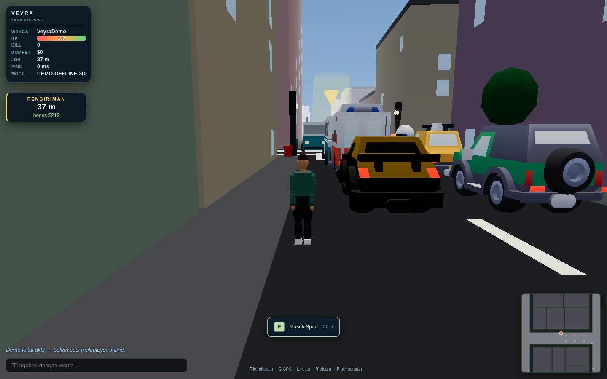

# Veyra: Neon District

[](https://github.com/xykal/veyra-neon-district/actions/workflows/ci.yml)

**Satu kota. Banyak cerita. Giliran lo bikin jejak.**

Independent browser-based **3D third-person multiplayer city sandbox**, inspired by the freedom of classic multiplayer city games. Built with Node.js + locally vendored Three.js. Desktop keyboard/mouse and mobile touch controls. No GTA / Rockstar / SA-MP game assets.

> **Alpha 0.2.0**, not a finished MMO. Real 3D rendering with a planar authoritative simulation; no jumping, interiors, vertical vehicle physics or account-login system yet. Performance depends on GPU, browser, heat and network—not a promise of 60 FPS on every device.



## Main features

- Third-person camera, animated humanoids, day/night, weather, building windows/neon, street furniture, pedestrians and wall fade.
- **18 vehicle classes:** sedan, sport, pickup, police, taxi, motorbike, tractor, ambulance, firetruck, garbage truck, delivery, SUV, luxury SUV, supercar, kart, shovel, van and original city bus. 17 GLB templates + procedural motorbike; shared driving model with braking, slip, handbrake, collision damage and suspension visuals.
- Server-owned movement, shooting, health, money, wanted/police pursuit, vehicle occupancy, delivery rewards and chat.
- **Saved progress:** wallet, kills/deaths, completed jobs, distance, play time and best speed. Atomic JSON writes every 10 seconds, on graceful shutdown, and retained on disconnect. Resume identity stays in this browser; the server stores only its SHA-256 hash. Names are display names, not authenticated accounts.
- **District Legends:** deduplicated saved/live top 25. Score = money + 100 × kills + 50 × jobs.
- **GPS:** 22 searchable destinations, keyword synonyms, road-following obstacle-free routes, 3D marker + minimap line. Named POIs are navigation locations, not functioning banks/shops/interiors.
- **Opt-in proximity voice:** WebRTC mesh, max 8 opted-in microphones, push-to-talk V/VOX, distance volume. No audio recording. HTTPS + mic permission required; STUN alone cannot traverse every NAT—production needs a suitable TURN service.
- Touch joystick, automatic sprint at full joystick travel, swipe look, held fire/brake/VOX, action/horn/chat/GPS/leaderboard/settings buttons. Portrait + landscape layouts and safe-area support.
- Low / balanced / high presets; auto FPS-based downgrade, adaptive render scale, instancing, nearby entity culling, reduced NPC/particle/shadow cost. **2D Lite fallback** when WebGL is unavailable.

## Run locally

Use **Node.js 22 or 24** (24 is used by the Docker runtime).

```sh
git clone https://github.com/xykal/veyra-neon-district.git
cd veyra-neon-district
npm start
```

Open **http://localhost:3000**. The runtime has **zero npm production dependencies**, so `npm install` is not needed just to play. Devices on the same LAN can open `http://YOUR-PC-IP:3000` if your firewall allows it. Voice requires HTTPS except browser-trusted localhost.

- `/` — 3D game
- `/2d/` — lighter 2D client, same server/progress
- `/?offline=1` or **Coba offline** — local simulation after page/assets load; not an installable offline-cache guarantee
- `/healthz` — deployment health check
- `/api/leaderboard` — public score rows, without profile secrets

No user API key is required. `.env.example` describes optional environment variables; the server reads process environment, not an automatic dotenv loader.

```sh
PORT=3000 DATA_DIR=./data MAX_PLAYERS=32 npm start
```

## Controls

| Desktop | Action |
|---|---|
| WASD / arrows | Walk; throttle/reverse/steer while driving |
| Shift | Sprint |
| F | Enter / exit nearby stopped vehicle |
| Space | Handbrake |
| Mouse; click | Look / lock pointer; fire (hold to repeat) |
| T; Enter | Open / send chat |
| Tab | Online players |
| G | GPS / destination search |
| L | District Legends |
| V (hold) | Opt in to mic, push-to-talk |
| H | Horn |
| P | Graphics / mic / fullscreen settings |
| Esc | Release pointer / close panels |

On mobile, use the left joystick and swipe on the right. **FIRE / NAIK / TURUN / REM / HORN** are on screen; the top row contains CHAT / GPS / SKOR / VOX / settings. Close buttons work without a keyboard. Rotate to landscape for more road visibility.

## Hosting / deployment

**This is not a static-only site.** Keep one long-running Node/Docker instance with HTTP + WebSocket and a persistent directory for progress. Do not put the entire authoritative game in a stateless static-site deployment.

**Recommended starting paths:**

1. **Render Web Service**, build from this repository's Dockerfile, attach persistent disk `/app/data`. `render.yaml` is a ready Blueprint **with a paid starter service + disk**; review provider pricing before approving it.
2. **Railway**, deploy this GitHub repository; Dockerfile + `railway.json` are included. Add a Volume at `/app/data`, set `DATA_DIR=/app/data`, generate a public HTTPS domain.
3. **VPS + Docker Compose**, for full control / persistent local storage.

Full click-by-click instructions, reverse proxy, TURN, backup and troubleshooting: **[docs/HOSTING.md](docs/HOSTING.md)**. No paid cloud service is provisioned by committing these files.

```sh
# From the cloned repo; builds locally and keeps progress in a named Docker volume.
docker compose up -d --build
# Open http://YOUR-SERVER-IP:3000 (put behind HTTPS before using voice).
```

`MAX_PLAYERS` is capped at 64 as a safety bound, **not a verified 64-player capacity claim**. Start small and load-test your chosen CPU / region. Use exactly **one replica**: the in-memory world and JSON persistence do not support horizontal scaling. Players reconnect after deployments, but position/vehicle/wanted are not restored.

## GitHub Actions & images

Every push to `main`, tag `v*`, PR, or manual run triggers:

1. Syntax / secret-pattern hygiene, 26 Node unit+integration tests on Node 22 **and** 24.
2. Seven Chromium browser tests covering desktop, mobile portrait/landscape, two-client chat/reconnect, 2D fallback and real two-peer WebRTC with fake microphone RTP.
3. Reproducible runtime packaging into an Actions artifact (`dist/` + `SHA256SUMS`).
4. **Only after tests pass**, build and push multi-architecture Docker images (`linux/amd64`, `linux/arm64`) to:

```text
ghcr.io/xykal/veyra-neon-district:latest
ghcr.io/xykal/veyra-neon-district:sha-<commit>
ghcr.io/xykal/veyra-neon-district:v0.2.0  # when that release tag is pushed
```

The published image is also started in CI: health endpoint, writable data directory and non-root game-process UID are checked.

Publishing uses Actions' built-in `GITHUB_TOKEN` with job-scoped package write permission—not an uploaded personal token. A newly created GHCR package can be private; its owner must check package visibility before unauthenticated pulling. Building directly from the GitHub Dockerfile avoids that dependency.

## Development / verification

```sh
npm ci --ignore-scripts
npm run check
npm test
npx playwright install --with-deps chromium
npm run test:e2e
npm run build
npm run assets       # regenerate original bus + model metadata only when changing assets
```

`npm run build` copies the self-contained runtime to `dist/`, strips dev dependencies, and emits file checksums. Start the result with `cd dist && npm start`. No external bundler or asset download is required to build.

Tests run with headless Chromium / SwiftShader; mobile settings are **emulation**, not physical Android/iPhone/Safari certification. The voice test confirms local peer negotiation and audio RTP; it is not a WAN/carrier-NAT/TURN test. See **[docs/TESTING.md](docs/TESTING.md)** for scope and remaining limits.

## Layout

```text
server/            HTTP, bounded RFC6455 transport, voice signalling, hashed profiles
shared/            Deterministic map, road GPS routing, authoritative game/physics
public/            Three.js client, touch UI, voice, GPS, graphics/audio, vendored assets
public/2d/         Lite client (same protocol)
tests/             Node integration + Playwright browser regression tests
tools/             Check, build, original bus generator, GLB metadata tools
.github/workflows/ CI, runtime artifact, multi-arch Docker publish
```

## Persistence, privacy & security

- Back up `DATA_DIR/profiles.json`. Keep the volume across deploys. Do not delete a Docker volume unless you intend to reset progress.
- Losing browser site data loses access to that resume identity. A copied resume token grants access to that profile; do not share it. One active tab per profile is enforced.
- JSON autosave can lose up to ~10 seconds on a hard kill; a normal SIGTERM flushes progress. Corrupt/unreadable profile files fail startup instead of silently resetting them.
- Microphone starts only with consent. Release V/VOX, blur/hide, disable, or leave to stop transmitting. Disable mic in settings to release the device entirely.
- WebSocket message size/rate/backpressure limits, heartbeat, idle-control release and browser-origin checks are implemented. This is still an alpha, not a production anti-cheat / account / moderation platform. See [SECURITY.md](SECURITY.md).
- Real `.env` files, `env.txt`, credential paths, local profiles and test reports are ignored and excluded from Docker context. Never commit them or put hosting tokens in browser JavaScript.

## License & credits

Project code/original assets: **MIT**. Three.js: MIT. Kenney Car Kit: CC0. See [THIRD_PARTY_NOTICES.md](THIRD_PARTY_NOTICES.md) and [vehicle credits](public/assets/cars/CREDITS.md).
