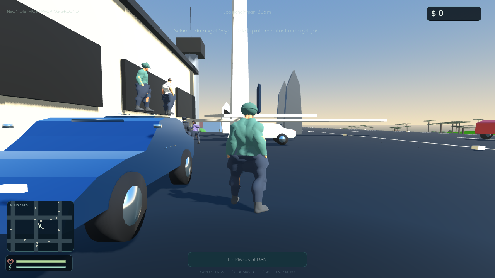
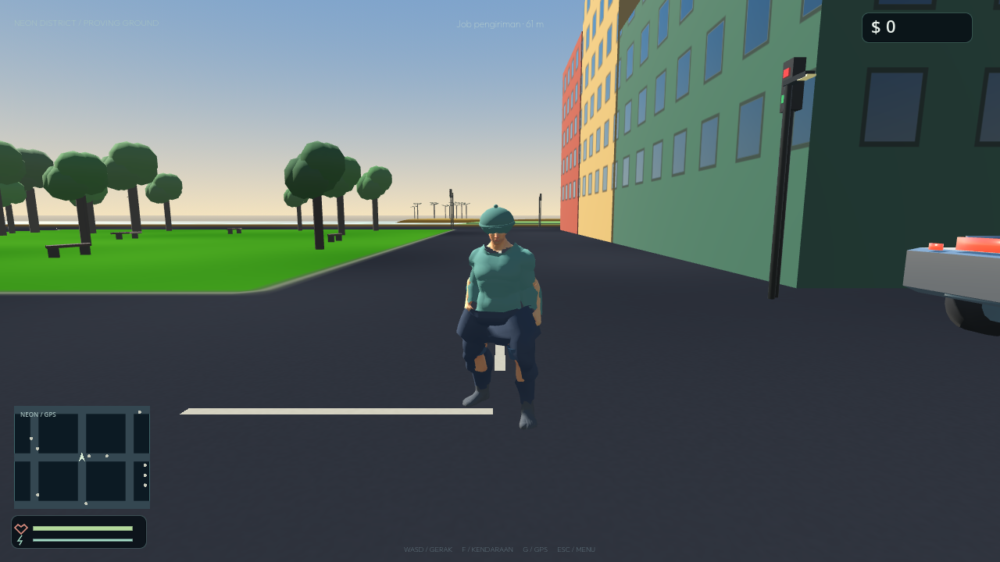
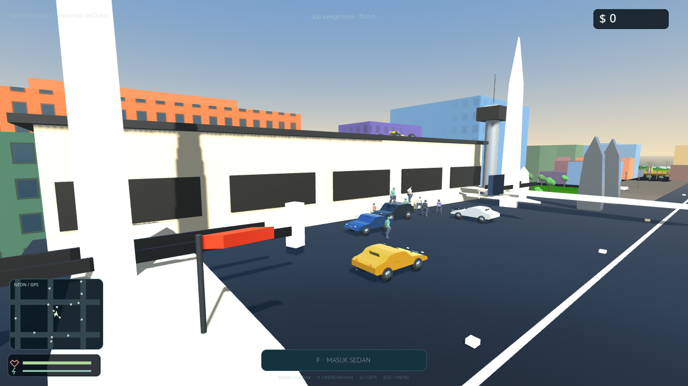
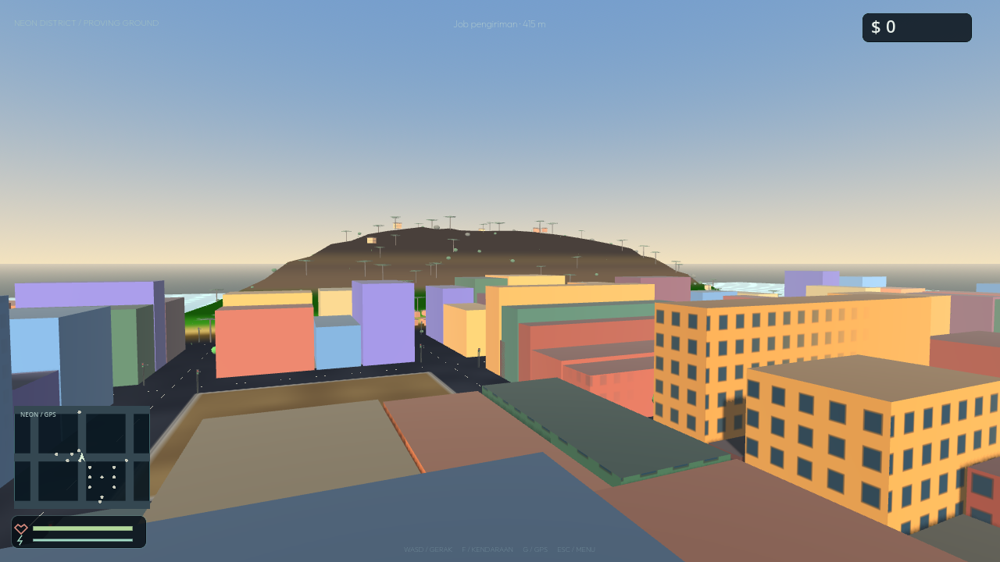
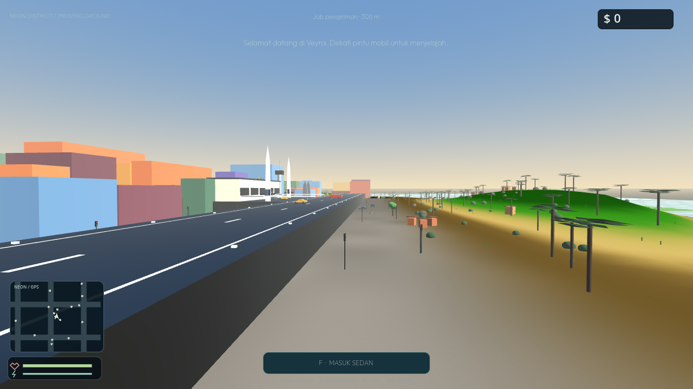

# Veyra

**Multiplayer roleplay in a living island city.** One shared world — streets, harbor, rice terraces, volcano, and an international airport where every new story begins.

[](https://github.com/xykal/veyra-neon-district/actions/workflows/ci.yml) [](https://github.com/xykal/veyra-neon-district/actions/workflows/native.yml)

**Play in browser:** [veyra-neon-district.dikanjut.workers.dev](https://veyra-neon-district.dikanjut.workers.dev) · **Download native alpha:** [Releases](https://github.com/xykal/veyra-neon-district/releases)

| | | |
|---|---|---|
|  |  |  |
| *Spawn: Bandara Internasional Veyra, complete with a terminal PA welcome* | *Street life — custom avatars, parked cars, palms and city blocks* | *Runway, apron, control tower and parked aircraft on the south coast* |

| | |
|---|---|
|  |  |
| *Lombok-inspired island: Mt. Rinjani behind the neon city* | *Runway 27 threshold — markings, edge lights, approach over the bay* |

## What Veyra is

An independent **third-person 3D multiplayer city sandbox** in the spirit of classic multiplayer city mods — but fully original: no GTA / Rockstar / SA-MP assets. Two clients, one world:

- **Veyra Native (Godot 4.7.2)** — the flagship. Real 3D client for **Windows and Android**, artist-authored characters and vehicles, native physics and sound. Current: **0.5.3-alpha.1**.
- **Veyra Web 0.3.0** — the original browser game (Three.js + authoritative Node/Workers backend), with `/2d/` lite fallback. Same server, same progression.

> Alpha software. Performance depends on your GPU, RAM, heat and network — we measure and report limits honestly instead of promising 60 FPS everywhere.

## Veyra Native — 0.5.3-alpha.1

- **True third-person 3D** — 65-bone skinned characters, 20 imported animation clips, emotes, jump/land, hit reactions, Jolt physical ragdolls.
- **Bandara Internasional Veyra** — new south-coast airport: 340 m runway with piano keys, centerline and edge lights, apron, terminal, control tower, parked aircraft, windsock and fuel farm. You spawn on the apron and get a **female terminal-PA welcome voice-over** (synthesized, with authentic band-limited PA echo).
- **18 vehicle classes** — sedan, sport, police, taxi, motorbike, tractor, ambulance, firetruck, garbage truck, delivery, SUV, luxury SUV, supercar, kart, shovel, pickup, van, city bus — Blender-authored meshes with round wheels, hub-true spin, glass/taillight/trim routing, suspension, drift and damage.
- **Lombok-inspired island** — Mt. Rinjani, rice terraces, beaches, harbor, warung, docks, villages and a dense neon city on a 60 m street grid with painted lane dashes and crosswalks.
- **Lobby & identity** — 360° character podium, vault of saved looks, Identity Studio clothing (streetwear, baggy fits), custom boot/loading splash (no engine logo).
- **Complete audio set** — 39 synthesized SFX: engines, skids, doors, horns, sirens, footsteps per surface, cloth, wind, rain, thunder, ocean, birds and UI.
- **Anti-stuck boot** — a boot watchdog recovers loading automatically (12 s stall → force-finish + toast), and a mobile-safe shader audit (no reserved GLSL words) removes a class of silent GPU compile failures.
- **Quality tiers** — Safe 12 vehicles / 2 NPCs, Balanced 24 / 4 / 2× MSAA, High 40 / 8 / 4× MSAA + distant terrain. Tuned for 2–3 GB Android devices, with headroom tiers for 6–8 GB+.

Measured on the software renderer used for CI captures (llvmpipe, not a phone), 0.5.2 baseline: ~38 ms/frame, 167 draw calls, 23.5 k primitives at Balanced (0.5.3 adds the airport on top of this). Treat it as a regression baseline, not a device benchmark. Test suite: avatar 48 · physics 25 · driver · touch 64 · performance 71 · app 11 · network 6 — all green in CI.

## Veyra Web 0.3.0

The original browser client still runs and shares the backend: server-owned movement, shooting with wall occlusion, wanted/police AI, delivery jobs, chat, scoreboard, GPS (22 POIs), proximity voice (opt-in WebRTC), day/night, weather, Identity Studio persistence, District Legends leaderboard and a 2D Lite fallback. Full feature notes in the [0.3 change log](docs/STUDIO-0.3.md) and [native guide](native/README.md).

## Run locally (web)

Node.js 22 or 24:

```sh
git clone https://github.com/xykal/veyra-neon-district.git
cd veyra-neon-district
npm start
```

Open **http://localhost:3000** — zero production npm dependencies. `/` is the 3D game, `/2d/` the lite client. Devices on your LAN can join via your PC's IP.

## Native builds

Every push builds Windows (.exe) and Android (arm64 / armv7) artifacts via [GitHub Actions](https://github.com/xykal/veyra-neon-district/actions/workflows/native.yml), tagged from `native/project.godot` and published to [Releases](https://github.com/xykal/veyra-neon-district/releases). To build locally you need Godot 4.7.2 + export templates; CI is the supported path. The native client also runs against the same multiplayer server (planar authoritative adapter — full 3D native multiplayer is on the roadmap).

## Limits, honestly

- Alpha: no interiors, no account login, no player trading/economy. Named POIs are navigation targets, not functional banks/shops.
- Native online play uses the planar authoritative server; vehicles and shooting are not yet full 3D-authoritative.
- No performance guarantee for all hardware. Phones with 2 GB RAM run the Safe tier; heat and GPU drivers matter.
- Web proximity voice needs HTTPS + a TURN server beyond localhost.

## Credits & license

Code and synthesized audio: **MIT**. Godot Engine: MIT. Quaternius human models/animations: **CC0**. Kenney car kit: **CC0**. Original assets only — no Rockstar/SA-MP content.

Made in the open by [xykal](https://github.com/xykal/veyra-neon-district) — selamat bertualang, warga baru.
